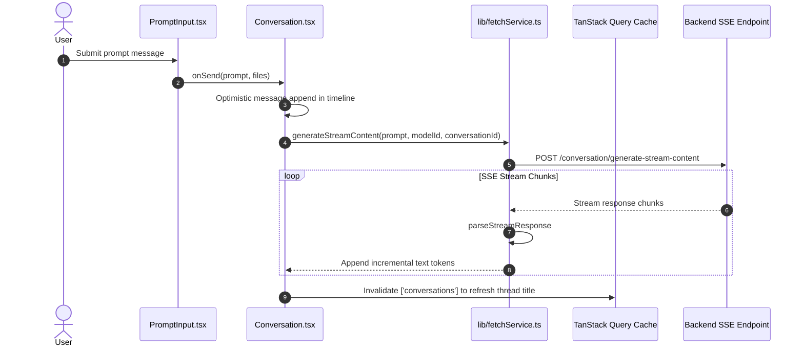

# MKK AI Agent - Frontend Architecture & Coding Skill

This skill is the architectural guide and development reference for the **MKK AI Agent Frontend** repository (React 19, TypeScript, Vite 8, Tailwind CSS v4, TanStack Query v5, Zustand).

---

## 📁 Directory Structure

```text
frontend/
├── public/                        # Static public assets & favicon
├── src/
│   ├── assets/                    # SVG assets and logos
│   ├── components/
│   │   ├── admin/                 # Admin management components
│   │   │   ├── tools/             # ToolCard, ToolFormModal, AgentCard, AgentFormModal, DynamicFieldBuilder
│   │   │   ├── dashboard/         # ModelUsage, ProviderUsage, TokenUsage charts
│   │   │   ├── ProviderFormModel.tsx # Provider & API key configuration form
│   │   │   └── user/              # User administration table & status columns
│   │   ├── auth/                  # Authentication forms (Login, SignUp, ResetPassword)
│   │   ├── common/                # Shared helpers (MetaHead.tsx dynamic SEO & OG headers)
│   │   ├── ui/                    # Reusable UI primitives (Buttons, Modals, Inputs, DataTable, StatusColumn)
│   │   └── user/                  # Core user chat & tools components
│   │       ├── chats/             # ChatHeader, ChatMessages, PromptInput, FileAttachment, ShareConversation
│   │       ├── tools/             # UserToolCard, UserAgentCard, AgentExecutionDialog
│   │       ├── settings/          # User settings modal (Profile, ChangePassword, Tokens, Usage)
│   │       └── SearchModel.tsx    # Modal for discovering and switching active AI models
│   ├── context/                   # React Context providers (ConversationContext, UserContext)
│   ├── hooks/                     # Custom hooks (useAppConfig, useDebounce, useInfinityScroll, useRecaptcha)
│   ├── layouts/                   # Layout wrappers (UserLayout with sidebar, AdminLayout)
│   ├── lib/                       # Core utilities (fetchService for SSE streaming, queryClient for cache)
│   ├── page/                      # Route page views
│   │   ├── admin/                 # Admin views (Dashboard, Providers, Tools, User)
│   │   ├── auth/                  # Auth views (Login, SignUp, GoogleCallback, ResetPassword)
│   │   └── user/                  # User views (Conversation, SharedConversation, Tools)
│   ├── routes/
│   │   └── AppRoutes.tsx          # React Router route definitions
│   ├── schemas/                   # Zod validation schemas (agentSchema, toolSchema, authSchema)
│   ├── stores/                    # Zustand stores (UserStore, AppStore)
│   ├── types/                     # Shared TypeScript interfaces & types (AGENT_FIELD_TYPES)
│   ├── App.tsx                    # Root provider setup (QueryClient, Router, Toastify)
│   ├── common.ts                  # Shared helpers (locale context, number format, static URLs)
│   ├── index.css                  # Global Tailwind CSS v4 directives
│   └── main.tsx                   # Vite client mount entry point
├── package.json                   # Dependencies & npm scripts
├── tsconfig.json                  # Root TypeScript config
└── vite.config.ts                 # Vite bundler configuration
```

---

## 🔄 Frontend Streaming Flow



---

## 💬 Conversation Lifecycle & Resilience (`Conversation.tsx`)

1. **Two-Stage Loading**:
   - While conversations or messages load, `ChatSkeleton.tsx` displays smooth placeholder blocks.
   - If conversation retrieval fails (404 Not Found or 403 Forbidden), a clear error card is displayed with a **"New Conversation"** button, and the prompt input is hidden to prevent invalid submissions.
2. **Input State Recovery**:
   - On submit, `PromptInput.tsx` clears the input text and attachments immediately.
   - If conversation creation or streaming fails, `restoreState(prompt, files)` automatically restores previous text and files so nothing is lost.
3. **Error Highlighting & Retry (`ChatMessage.tsx`)**:
   - Assistant turns with `isError: true` render in a red-tinted alert card with an `AlertCircle` icon and an instant **Retry** button.
4. **Agent Auto-Stream Navigation**:
   - When launching an agent from `AgentExecutionDialog`, the user is navigated to `/:conversationId` with `location.state.autoStream`.
   - `Conversation.tsx` automatically detects this state, sets the model, and begins streaming the response immediately.

---

## ⚡ Centralized Fetch & Streaming Service (`src/lib/fetchService.ts`)

1. **401 Token Refresh**:
   - Automatically detects 401 Unauthorized responses, calls `/auth/refresh-token`, and retries the failed request with the new access token.
2. **Chunk Healing**:
   - High-throughput SSE chunks can arrive joined together (e.g. `}{`). `parseStreamResponse` automatically heals and parses them safely.
3. **File Attachment Streaming**:
   - Prompts, model IDs, conversation IDs, and uploaded files are automatically packaged into `FormData` and sent as `multipart/form-data`.

---

## 📎 File Attachments & Preview Engine

1. **Attachment Badges**:
   - Supports documents (PDF, DOCX, TXT, CSV) and images with filename deduplication.
   - Rendered as responsive badges with max-width, word ellipsis, and hover tooltips.
2. **Interactive Preview Modal (`FilePreviewModal.tsx`)**:
   - Clicking any attachment pill opens a preview modal for code syntax highlighting, document text, embedded PDF viewing, or image inspection.
3. **Protected Blob URLs (`src/hooks/useAttachmentUrl.ts`)**:
   - Fetches protected attachments with `Authorization` headers and creates temporary Blob URLs (`URL.createObjectURL`). URLs are automatically revoked on unmount to prevent memory leaks.
4. **Scroll-to-Bottom Button**:
   - A floating scroll-to-bottom button appears directly above the input box whenever the user scrolls up in the chat.

---

## 🗃️ State Management

1. **Server State (TanStack Query v5 via `src/lib/queryClient.ts`)**:
   - `['coversations']`: Thread list in the sidebar.
   - `['coversationsMessage', conversationId]`: Thread messages timeline.
   - `['appConfig']`: Public app configuration and limits from `GET /config`.
2. **Client Global State (Zustand)**:
   - `UserStore`: Authentication profile, role (`USER` vs `ADMIN`), and tokens.
   - `AppStore`: Global UI toggles and sidebar collapse state.
3. **Context State (React Context)**:
   - `ConversationContext`: Holds active model selection, conversation ID, and draft input state.

---

## 🪝 Key Custom Hooks

- `useAppConfig()`: Fetches public configuration from `GET /config` (file size limits, allowed extensions, and dynamic agent field rules).
- `useDebounce(value, delay = 300)`: Debounces search inputs to avoid unnecessary network requests.
- `useInfinityScroll(callback)`: Uses `IntersectionObserver` to trigger pagination smoothly when scrolling near list ends.
- `useRecaptcha()`: Loads Google reCAPTCHA v3 on auth pages (`Login`, `SignUp`, `ResetPassword`) and automatically removes the badge on authenticated views.

---

## ⚙️ Development Commands

```bash
# Start development server (http://localhost:3000)
npm run dev

# Build for production
npm run build

# Preview production build
npm run preview
```

---

## ⚠️ Key Development Rules

- **Tailwind CSS v4 & Standard Units**:
  - Never use arbitrary pixel classes like `h-[100px]`, `min-h-[300px]`, or `text-[10px]`.
  - Always use standard Tailwind units (`px / 4`): `h-25`, `min-h-75`, `max-w-50`, `text-xs`, `text-sm`, `text-base`.
- **No Mutating Git Commands**: Do NOT run `git add`, `git commit`, `git push`, or `git checkout`. Leave all changes as working tree edits for the user to review.
- **Never Touch `.env`**: Never read or write live `.env` files. Always use `.env.example` as the canonical template.
- **AI Agent Tools Design**:
  - Single indigo theme across buttons, badges, highlights, and toggle switches.
  - On-Demand Loading: `GET /tool` loads minimal card metadata; dynamic fields (minimum 1, maximum 5) load via `GET /agent/:id` when launching or editing. Duplicate field keys are not permitted.
  - Dynamic file uploads enforce a 5MB limit and 1 file per upload field.
  - Agent system prompts are isolated and never exposed in the client UI.
- **Optimistic Timeline Updates**: Display user messages immediately in the timeline before network calls finish.
- **Safe Keys**: All API requests must route through `fetchService.ts` or `common.ts` with proper token headers.
