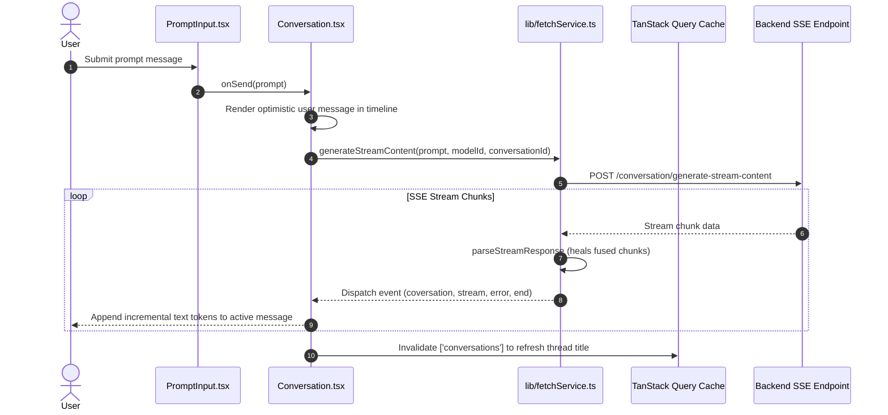

# MKK AI Agent - Frontend Architecture & Coding Skill

This skill provides the standalone architectural blueprint, directory structure, and development runbooks for the **MKK AI Agent Frontend** repository (React 19, TypeScript, Vite 8, Tailwind CSS v4, TanStack Query v5, Zustand).

---

## 📁 Frontend Directory Structure

```text
frontend/
├── public/                        # Static public assets & favicon
├── src/
│   ├── assets/                    # SVG assets, logos (logo.svg)
│   ├── components/
│   │   ├── admin/                 # Admin management components
│   │   │   ├── ModelUsage.tsx     # Model consumption analytics
│   │   │   ├── ProviderForm.tsx   # Provider & API key configuration form
│   │   │   ├── ProviderUsage.tsx  # Provider usage distribution
│   │   │   ├── TokenUsage.tsx     # Global token usage analytics
│   │   │   └── user/              # User administration table & status columns
│   │   ├── auth/                  # Authentication forms (Login, SignUp, ResetPassword)
│   │   ├── common/                # Common components (MetaHead.tsx dynamic SEO & OG headers)
│   │   ├── ui/                    # Reusable dumb UI primitives (Buttons, Modals, Inputs, DataTable)
│   │   └── user/                  # Core user chat components
│   │       ├── chats/
│   │       │   ├── ChatHeader.tsx # Model details, conversation controls, title & share button
│   │       │   ├── ChatMessages.tsx # Linear message timeline renderer (supports isShared)
│   │       │   ├── ConversationOptions.tsx # Conversation dropdown menu with share option
│   │       │   ├── NavConversations.tsx # Sidebar with debounced search & infinite scroll
│   │       │   ├── PromptInput.tsx # User input area with submit & abort triggers
│   │       │   └── ShareConversation.tsx # Share modal (Restricted default, Public, Specific User)
│   │       ├── settings/          # User settings modal (Profile, ChangePassword, Tokens, Usage)
│   │       └── SearchModel.tsx    # Modal for discovering and switching active AI models
│   ├── context/                   # React Context providers
│   │   ├── conversationContext.tsx# Active conversation ID, model selection, draft state
│   │   └── userContext.tsx        # Active user session context
│   ├── hooks/                     # Custom performance & UI hooks
│   │   ├── useBreakpoint.tsx      # Viewport responsive breakpoint detector
│   │   ├── useDebounce.tsx        # Search query debouncing (300ms delay)
│   │   ├── useInfinityScroll.tsx  # IntersectionObserver infinite scrolling trigger
│   │   ├── useOutsideClick.tsx    # Modal & dropdown dismiss handler on outside click
│   │   └── useRecaptcha.ts        # Google reCAPTCHA v3 invisible token executor
│   ├── layouts/                   # Layout wrappers
│   │   ├── admin/                 # AdminLayout, Header, NavBar
│   │   ├── user/                  # UserLayout, NavBar (collapsible Pinned & Recents)
│   │   └── Footer.tsx             # Global footer
│   ├── lib/                       # Core utilities & API clients
│   │   ├── fetchService.ts        # SSE streaming handler (`parseStreamResponse`), token refresh
│   │   └── queryClient.ts         # TanStack QueryClient instance & cache configuration
│   ├── page/                      # Route page views
│   │   ├── admin/                 # Admin pages (Dashboard, Providers, User)
│   │   ├── auth/                  # Auth pages (Login, SignUp, GoogleCallback, EmailVerification, ResetPassword)
│   │   └── user/                  # Core user pages (Conversation/Chat, Privacy, SharedConversation)
│   ├── routes/
│   │   └── AppRoutes.tsx          # React Router v7 routes definition (/auth/google/callback, /share/:id)
│   ├── schemas/                   # Zod validation schemas (authSchema, providerSchema, userSchema, conversationSchema)
│   ├── stores/                    # Zustand global client stores
│   │   ├── AppStore.ts            # UI states, sidebar collapse toggle
│   │   └── UserStore.ts           # Authenticated user profile, roles, tokens
│   ├── types/                     # Shared TypeScript interfaces (conversation, user, common)
│   ├── App.tsx                    # Root provider setup (QueryClientProvider, Router, Toastify)
│   ├── common.ts                  # Base Axios instance & response handlers
│   ├── data.tsx                   # Static icon & navigation datasets
│   ├── index.css                  # Global Tailwind CSS v4 directives
│   └── main.tsx                   # Vite client mount entry point
├── index.html                     # HTML application template
├── package.json                   # Dependencies & npm scripts
├── tailwind.config.js             # Tailwind CSS configuration
├── tsconfig.json                  # Root TypeScript config
├── tsconfig.app.json              # App-specific TypeScript config
├── tsconfig.node.json             # Node-specific TypeScript config
└── vite.config.ts                 # Vite bundler configuration
```

---

## 🔄 Frontend Streaming & Execution Flow



---

## 💬 Conversation Lifecycle & Error Handling (`src/page/user/Conversation.tsx`)

1. **Two-Stage Loading**:
   - When mounting or navigating to `/c/:id`, `Conversation.tsx` first fetches the conversation record via `getConversation`.
   - If conversation retrieval fails (e.g. 404 Not Found or 403 Forbidden):
     - Displays a clear error banner/state with a **"New Conversation"** button directing the user to `/new`.
     - **Hides the prompt input completely** so invalid messages cannot be dispatched.
   - If conversation retrieval succeeds, proceeds to fetch conversation message history (`getConversationMessages`) and renders the chat timeline.
2. **Dynamic Header SEO (`<MetaHead>`)**:
   - Hydrates document `<title>` with the active conversation title (or fallback "AI Agent - Conversational Intelligence Platform").
   - Applied consistently across user chat, shared conversations, admin dashboards, and settings.

---

## ⚡ Core Streaming Protocol (`src/lib/fetchService.ts`)

1. **Chunk Healing**:
   - High-throughput SSE chunks often arrive fused together (e.g. `}{`). `parseStreamResponse` automatically detects and inserts commas (`},{`) before parsing.
2. **Event Types**:
   - `coversation`: Receives created conversation UUID. Updates URL parameter (`/c/:id`).
   - `stream`: Appends real-time incremental text delta to current active message.
   - `error`: Displays toast notification and restores input prompt.
   - `end`: Marks streaming completion and triggers cache invalidation.

---

## 🗃️ State Management Strategy

1. **Server State (TanStack Query v5 via `src/lib/queryClient.ts`)**:
   - Configured in `src/lib/queryClient.ts` with `staleTime: 1 hour` and `retry: 1`.
   - `['conversations']`: Sidebar thread list (invalidated on stream end, thread rename, delete).
   - `['messages', conversationId]`: Thread messages timeline.
2. **Client Global State (Zustand)**:
   - `UserStore`: Authentication profile, role (`USER` vs `ADMIN`), tokens.
   - `AppStore`: Global UI states, sidebar collapse toggle.
3. **Context State (React Context)**:
   - `ConversationContext`: Holds active model selection, conversation ID, and draft prompt state.

---

## 🪝 Custom Performance Hooks (`src/hooks/`)

- `useDebounce(value, delay = 300)`: Used on search inputs in `NavConversations.tsx` to prevent redundant network calls while typing.
- `useInfinityScroll(callback)`: Encapsulates `IntersectionObserver` to trigger `fetchNextPage` automatically when the user scrolls near the bottom of lists.
- `useBreakpoint()`: Responsive screen width breakpoint detection.
- `useOutsideClick(ref, callback)`: Closes modals, dropdowns, and flyout menus when clicking outside.
- `useRecaptcha()`: Dynamically loads Google reCAPTCHA v3 script on unauthorized authentication pages (`Login`, `SignUp`, `ResetPassword`) with automatic cleanup hiding the `.grecaptcha-badge` upon unmount or navigating to authorized pages.

---

## 🔗 Conversation Sharing & Collapsible Navigation

1. **Share Modal (`ShareConversation.tsx`)**:
   - Manages sharing state via React Hook Form and Zod (`conversationSchema.ts`).
   - Defaults to `RESTRICTED` share type, hiding the share link until changed to `PUBLIC` or `SPECIFIC_USER`.
   - Fetches available share options (`/conversation/share/options`) and existing settings (`/conversation/:id`).
   - Supports `PUBLIC` links and `SPECIFIC_USER` access with dynamic email tagging and inline error validation.
   - Automatically merges and validates any uncommitted text in the email input upon form submission.
   - Provides one-click clipboard link copying (`/share/:id`).

2. **Public Shared View (`SharedConversation.tsx`)**:
   - No-auth public page mounted at `/share/:id`.
   - Reads conversation metadata from `/shared/conversation/:id` and loads messages using `ChatMessages` (`isShared={true}`).
   - Displays share link copy button and contextual "New Chat" (if logged in) or "Log in" action buttons.

3. **Collapsible Sidebar Sections (`NavBar.tsx`)**:
   - `isPinnedOpen` and `isRecentOpen` states manage expansion of the **Pinned** and **Recents** conversation lists.
   - Headers include `ChevronDown` icons that smoothly rotate `-rotate-90` on collapse.
   - Seamless infinite scrolling pagination without scroll-jumping on page fetches.

---

## 🔐 Authentication, OAuth2 & Anti-Bot Protocols

1. **Google OAuth2 & Secure Token Flow**:
   - Initiated via native anchor `<a href="/api/auth/google">` in `Login.tsx` and `SignUp.tsx`.
   - Backend redirects to `/auth/google/callback?token=${accessToken}` without exposing personal user data in URL query strings.
   - `GoogleCallback.tsx` captures the token, sets it into `UserStore`, securely fetches profile data via `GET /api/auth/user`, displays a deduplicated success toast (`processedRef` + `toastId: "google-login-success"`), and navigates home.

2. **Hybrid Password Management**:
   - `Account.tsx` checks `isCreatePassword = !user?.hasPassword`.
   - If the user logged in via Google and has no password, the settings tab dynamically renders **"Create Password"** (omitting the Old Password field).
   - Once submitted, the backend hashes the password, marks `hasPassword: true`, and the UI dynamically converts to "Change Password".
   - Accounts without a set password are prevented from logging in via email & password until one is created.

3. **Scoped Google reCAPTCHA v3 Bot Defense**:
   - `executeRecaptcha(action)` is called prior to network mutation in `Login.tsx` (`login`), `SignUp.tsx` (`register`), and `ResetPassword.tsx` (`forgot_password`, `reset_password`).
   - Attaches `captchaToken` to request bodies for backend verification.
   - **Isolation & Cleanup**: The Google badge `.grecaptcha-badge` is mounted strictly on unauthenticated auth routes and automatically unmounted/hidden when navigating into the authenticated app (`Layout.tsx`, `AdminLayout.tsx`).

---

## ⚙️ Development & Verification Runbook

### Prerequisites
- Node.js v18+

### Commands
```bash
# Start development server (runs on http://localhost:3000 or http://localhost:5173)
npm run dev

# Build for production
npm run build

# Preview production build
npm run preview
```

---

## ⚠️ Critical Rules & Conventions

- **Tailwind CSS v4**: Use modern utility classes with responsive variants (`sm:`, `md:`, `lg:`).
- **Optimistic Updates**: Render user prompts immediately in the timeline before network responses resolve.
- **Debounced Search**: Always debounce search inputs to preserve API bandwidth.
- **Safe Keys**: API calls must pass through `fetchService.ts` or `common.ts` with proper token interception.
- **Header Metadata**: Always use `<MetaHead>` on route page views to ensure accurate dynamic document titles and OpenGraph tags.
- **Environment Protection**: **NEVER read or write `.env` files**. Use `.env.example` as the canonical template for variable names and schemas.

