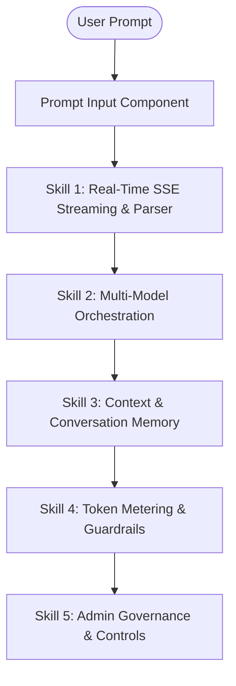

# 🧠 AI Agent Skills & System Capabilities

This document outlines the core agent capabilities, streaming processing pipelines, model orchestration skills, token guardrails, and administrative supervision features built into the **AI Agent Web Application**.

---

## 📋 Overview of Agent Capabilities

The AI Agent system delivers real-time conversational intelligence, multi-model execution, context-aware memory retention, and fine-grained token usage controls.

---

## 🛠️ Core Agent Skills Inventory

### 1. ⚡ Real-Time SSE Streaming & Response Parsing Skill

- **Description**: Handles continuous Server-Sent Event (SSE) streaming output from AI models, supporting high-throughput real-time text rendering.
- **Key Modules**: [Home.tsx](file:///var/www/html/ai-agent/frontend/src/page/user/Home.tsx), [fetchService.ts](file:///var/www/html/ai-agent/frontend/src/services/fetchService.ts)
- **Technical Capabilities**:
  - **Fused Chunk Parser (`parseStreamResponse`)**: Automatically handles fused JSON buffers (`}{` -> `},{`) and employs regex fallback matching for fragmented chunks.
  - **Event Types**:
    - `coversation`: Binds conversation ID, updates routing, invalidates cache queries.
    - `stream`: Appends real-time streamed text delta to current view state.
    - `error`: Displays toast error notifications and restores prompt state.
    - `end`: Marks streaming completion.
  - **Regeneration & Editing**: Allows users to retry streaming from a specific message ID (`retry-stream-content`).

---

### 2. 🤖 Multi-Model Orchestration Skill

- **Description**: Enables switching dynamically between underlying LLMs (e.g., Gemini, OpenAI, Claude, or custom fine-tuned models) without losing conversation context.
- **Key Modules**: [SearchModel.tsx](file:///var/www/html/ai-agent/frontend/src/components/user/SearchModel.tsx), [ChatHeader.tsx](file:///var/www/html/ai-agent/frontend/src/components/user/chats/ChatHeader.tsx)
- **Technical Capabilities**:
  - **Dynamic Model Selection**: Select models per conversation thread or override on individual queries.
  - **Model Discovery**: Search, filter, and view details for available models.
  - **Model Parameter Injection**: Automatically attaches `modelId` to the streaming generation requests.

---

### 3. 💬 Context & Conversation Management Skill

- **Description**: Maintains conversation memory, state synchronization, message history retrieval, and thread management.
- **Key Modules**: [NavConversations.tsx](file:///var/www/html/ai-agent/frontend/src/components/user/chats/NavConversations.tsx), [ConversationOptions.tsx](file:///var/www/html/ai-agent/frontend/src/components/user/chats/ConversationOptions.tsx), [ConversationContext](file:///var/www/html/ai-agent/frontend/src/context/conversationContext.ts)
- **Technical Capabilities**:
  - **Thread Persistence**: Seamless navigation between chat threads with full message caching via **TanStack Query**.
  - **Thread Editing**: Rename chat titles, delete threads, and edit past prompts.
  - **Contextual Memory**: Automatically passes `conversationId` to preserve multi-turn agent history.

---

### 4. 🪙 Token Metering & Usage Guardrails Skill

- **Description**: Monitors token consumption, enforces account quotas, and prevents request execution when user balances are depleted.
- **Key Modules**: [Tokens.tsx](file:///var/www/html/ai-agent/frontend/src/components/user/settings/Tokens.tsx), [TokenUpdateForm.tsx](file:///var/www/html/ai-agent/frontend/src/components/user/settings/TokenUpdateForm.tsx)
- **Technical Capabilities**:
  - **Balance Monitoring**: Live display of current token balance and package tier.
  - **Token Package Top-Up**: User modal for updating API keys, redeeming credits, or upgrading token tier.
  - **Quota Enforcement**: Handles backend `402 Payment Required` or token error responses with prompt rollback and user warnings.

---

### 5. 🛡️ Admin Governance & Supervision Skill

- **Description**: Provides administrative oversight, user control, system metrics monitoring, and token allocation rules.
- **Key Modules**: [User.tsx](file:///var/www/html/ai-agent/frontend/src/page/admin/User.tsx), [Tokens.tsx](file:///var/www/html/ai-agent/frontend/src/page/admin/Tokens.tsx), [Dashboard.tsx](file:///var/www/html/ai-agent/frontend/src/page/admin/Dashboard.tsx)
- **Technical Capabilities**:
  - **User Access Controls**: Admin table to activate/suspend user accounts and edit roles.
  - **Global Token Allocations**: Ability for admins to credit or modify token balances per user.
  - **Telemetry Dashboard**: System monitoring view showing token consumption trends and agent usage metrics.

---

## 🚀 Guide: Extending & Adding New Agent Skills

To add a new tool or agent skill (e.g., Code Execution, Web Search, Image Generation):

1. **Define the Response Schema**:
   Add the tool output type to `src/types/type.ts` or `src/types/conversation.ts`.

2. **Update the Stream Parser**:
   In [Home.tsx](file:///var/www/html/ai-agent/frontend/src/page/user/Home.tsx#L32-L94), add handling for the new event type in `handleStreamResponse` (e.g., `tool_call` or `tool_result`).

3. **Create Component Renderer**:
   Add a specialized UI component in `src/components/user/chats/` to render rich tool output (e.g. dynamic tables, code sandboxes, interactive widgets).

---

## 📄 License & System Notice

This documentation is maintained alongside the AI Agent frontend codebase. All agent skills are governed by user permissions and system configuration.
