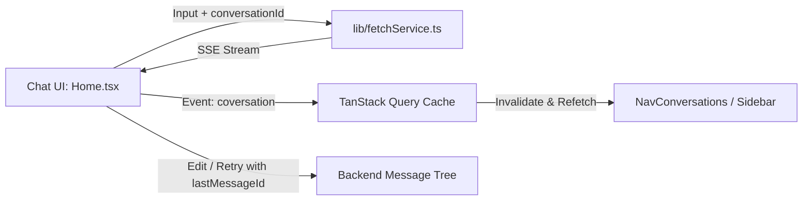

# MKK AI Agent - Frontend

Modern, high-performance web application for the MKK AI Agent platform. Built with React 19, Vite, Tailwind CSS v4, and TanStack React Query, featuring real-time SSE stream rendering, thread memory navigation, and multi-model switching.

---

## 🛠️ Tech Stack

- **Framework & Language**: React 19, TypeScript
- **Build Tool**: Vite 8
- **Styling**: Tailwind CSS v4, Lucide React Icons
- **State Management**: Zustand (`AppStore`, `UserStore`), React Context (`ConversationContext`, `UserContext`)
- **Data Fetching & Cache**: TanStack React Query v5
- **Routing**: React Router DOM v7
- **Forms & Validation**: React Hook Form, Zod
- **Markdown & Streaming**: `@tanstack/markdown`, Custom SSE chunk parser

---

## 📁 Directory Structure

```text
frontend/
├── public/                 # Static assets & favicon
├── src/
│   ├── assets/             # Brand logos & icons (logo.svg)
│   ├── components/
│   │   ├── admin/          # Admin management (User tables, token meters)
│   │   ├── auth/           # Login, Register, Password forms
│   │   ├── ui/             # Reusable UI primitives (Buttons, Modals, Inputs)
│   │   └── user/           # User chat UI (ChatHeader, NavConversations, SearchModel)
│   ├── context/            # ConversationContext & UserContext providers
│   ├── hooks/              # Custom utilities
│   │   ├── useBreakpoint.tsx     # Viewport responsive breakpoint detector
│   │   ├── useDebounce.tsx       # Search query debouncing (300ms)
│   │   ├── useInfinityScroll.tsx # IntersectionObserver infinite scrolling
│   │   └── useOutsideClick.tsx   # Modal & dropdown dismiss handler
│   ├── layouts/            # UserLayout, AdminLayout, and Footer
│   ├── lib/                # Core utilities & API clients
│   │   ├── fetchService.ts # SSE streaming handler (`parseStreamResponse`)
│   │   └── queryClient.ts  # TanStack QueryClient instance & cache configuration
│   ├── page/
│   │   ├── admin/          # Admin views (Dashboard, Providers, User)
│   │   ├── auth/           # Auth views (Login, SignUp, EmailVerification, ResetPassword)
│   │   └── user/           # Core user views (Home/Chat, Privacy)
│   ├── routes/             # AppRoutes router definitions
│   ├── schemas/            # Zod validation schemas (auth, user, provider)
│   ├── stores/             # Zustand global stores (AppStore.ts, UserStore.ts)
│   ├── types/              # TypeScript definitions (conversation, user, common)
│   ├── App.tsx             # Root app provider setup (QueryClientProvider, Router)
│   ├── common.ts           # Base Axios instance & response handlers
│   ├── data.tsx            # Static icon & navigation datasets
│   ├── index.css           # Global stylesheet & Tailwind CSS rules
│   └── main.tsx            # Vite client entrypoint
├── index.html              # HTML shell
├── package.json            # Project dependencies & scripts
├── tailwind.config.js      # Tailwind configuration
├── tsconfig.json           # TypeScript configuration
└── vite.config.ts          # Vite configuration
```

---

## 🤖 Core Agent Capabilities

The frontend client integrates:
- ⚡ **Real-Time SSE Streaming & Parser**: Continuous stream delta rendering with fused-chunk error recovery.
- 🔍 **Autonomous Web Search & Grounding**: Visualization of live search queries, tool execution states, and grounded sources.
- 🤖 **Multi-Model Orchestration**: Dynamic model discovery, filtering, and seamless provider switching.
- 💬 **Conversation Tree Navigation**: Linear timeline projection of branched turns, retries, and prompt edits.
- 🪙 **Token Metering & Guardrails**: Account balance tracking, package management, and quota enforcement.
- 🛡️ **Admin Supervision**: Provider configuration, model migration, and user administration.

---

## 🧠 Agent Memory & State Interaction

The frontend interfaces with the backend agent memory layers to ensure seamless conversational continuity:



### 1. Active Thread Context

- `ConversationContext` holds the currently selected `conversationId`, message chain, and active model parameters.
- Switching threads instantly hydrates chat messages from TanStack Query's cache (`['messages', conversationId]`) before background validation.

### 2. Message History & Tree Navigation

- **Linear Projection**: Displays parent-child message chains from the backend relational tree into an intuitive linear chat timeline.
- **Retrying & Editing**: Triggering a prompt edit or message retry sends `lastMessageId` to the backend to create or link new sibling turns without losing prior history.

### 3. Client State & Cache Synchronisation

- **Optimistic UI Updates**: New user prompts are immediately rendered in the timeline while the SSE stream connects.
- **Cache Invalidation**: On stream end (`end` event), the conversation list query is invalidated to synchronize updated thread names and timestamps.

---

## 🔄 Core Frontend Workflows

### 1. Real-Time Streaming Chat Flow

1. User enters prompt in `Home.tsx` and selects an AI model from `SearchModel.tsx`.
2. `fetchService.ts` initiates an SSE stream connection (`/conversation/generate-stream-content`).
3. Stream parser handles event types:
   - `coversation`: Captures new conversation UUID, updates browser URL.
   - `stream`: Appends real-time token deltas into active message view state.
   - `error`: Displays toast notification and restores user input prompt.
   - `end`: Completes stream lifecycle.

### 2. Debounced Search & Infinite History Flow

1. User types in search input within `NavConversations.tsx`.
2. `useDebounce` delays network query by `300ms`, minimizing redundant API requests.
3. `useInfinityScroll` monitors bottom sentinel via `IntersectionObserver` to trigger `fetchNextPage` automatically.

---

## 🚀 Getting Started

### Prerequisites

- Node.js v18+

### Setup

```bash
# 1. Install dependencies
npm install

# 2. Start development server (runs on http://localhost:3000 or http://localhost:5173)
npm run dev

# 3. Build for production
npm run build

# 4. Preview production build
npm run preview
```

### Post-Setup Admin Configuration

Once setup is complete:
1. Log in with an Admin account (default: `admin@gmail.com` / `Admin@123`).
2. Navigate to the **Admin Dashboard > Providers** page.
3. Configure the **Gemini** and **OpenAI** API keys.
4. Migrate/sync available models from providers.
5. Update the status (`ACTIVE` / `INACTIVE`) of models and providers as needed.
