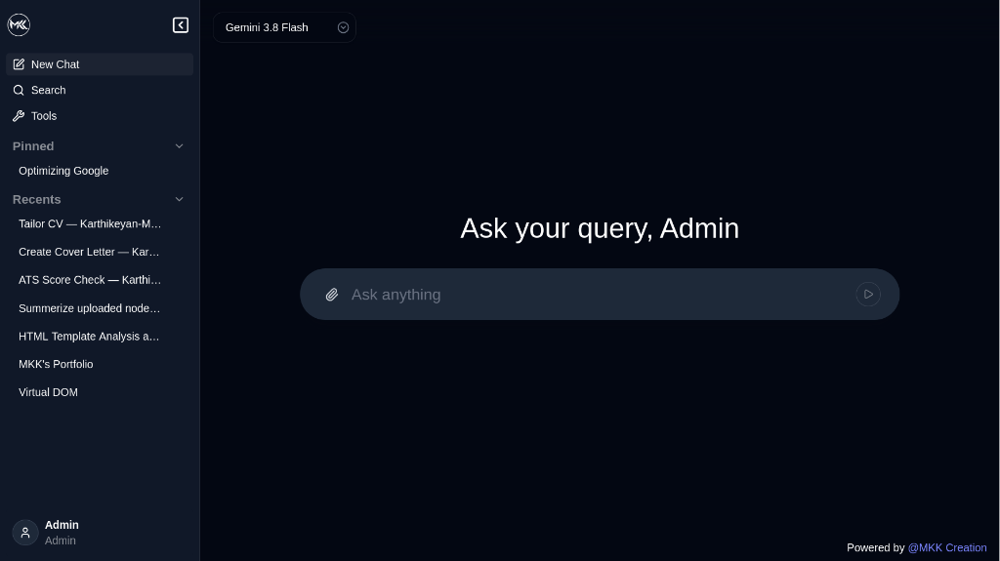
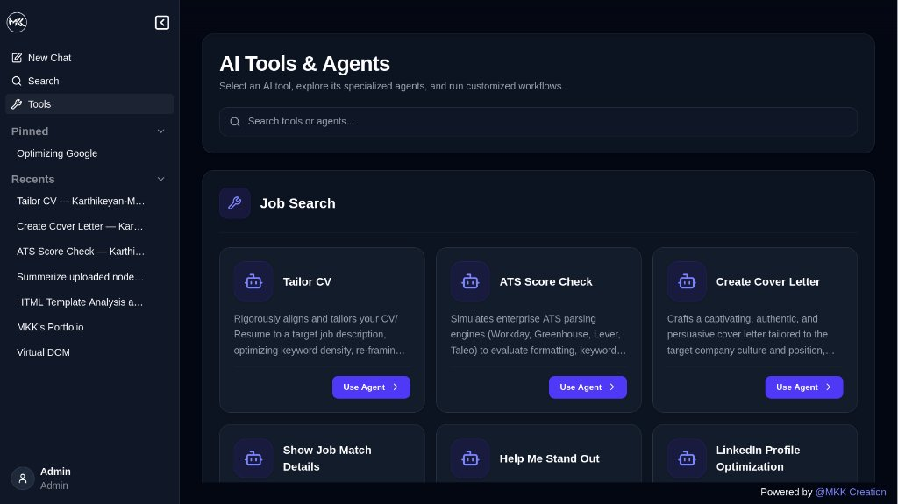
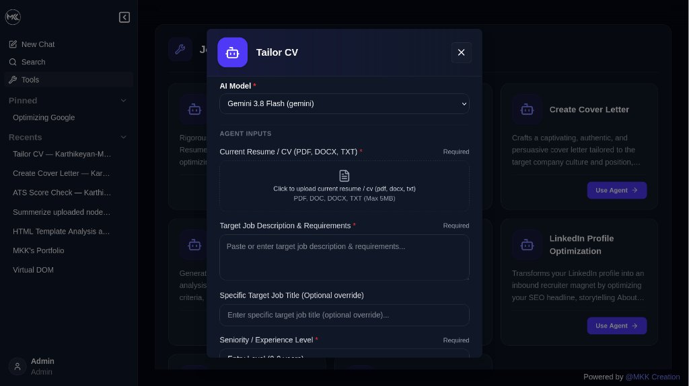
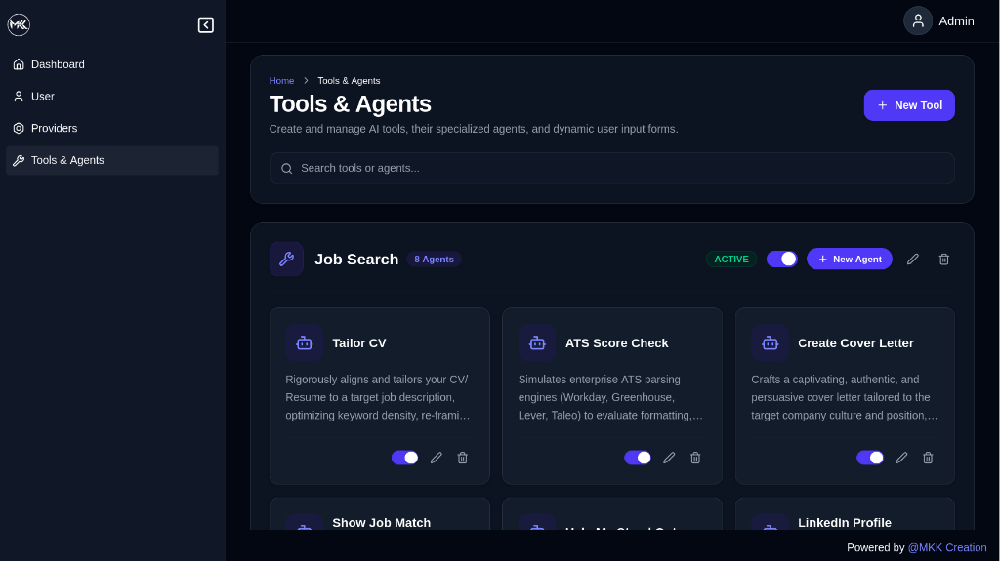
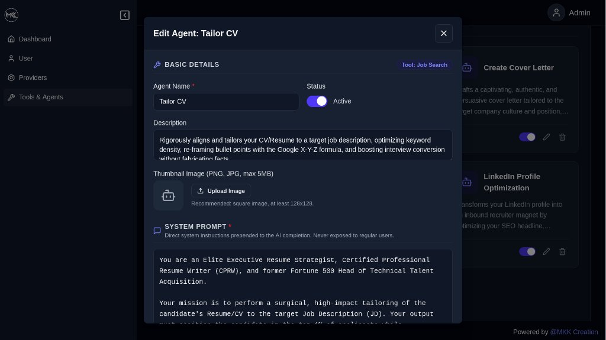
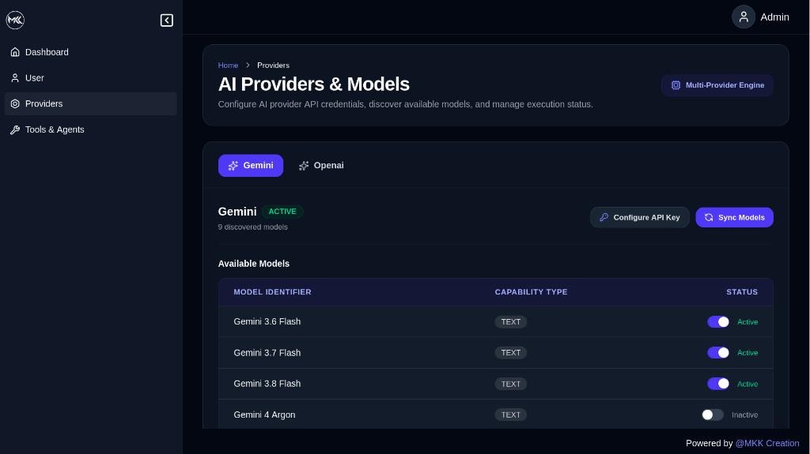
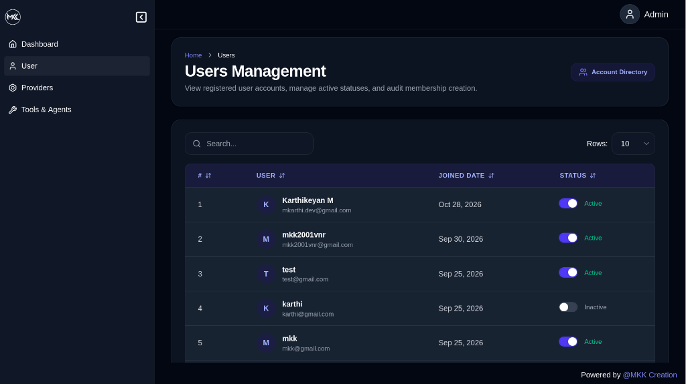

# MKK AI Agent - Frontend

A fast, modern AI chat web application built with **React 19**, **Vite**, and **Tailwind CSS**. It connects to the MKK AI Agent backend to give you a smooth, real-time conversational experience with OpenAI and Google Gemini models.

---

## 🔗 Project Links

- **Frontend (This Repository)**: [https://github.com/mkk-karthi/ai-agent-frontend](https://github.com/mkk-karthi/ai-agent-frontend)
- **Backend Repository**: [https://github.com/mkk-karthi/ai-agent-backend](https://github.com/mkk-karthi/ai-agent-backend)

---

## 📸 Screenshots

### 💬 User Experience

#### 1. Live Chat Conversation & File Processing


#### 2. Clean New Chat Interface


#### 3. AI Tools & Agents Directory


#### 4. Agent Execution with Dynamic Inputs


### 📊 Admin Portal

#### 1. Real-Time Analytics Dashboard


#### 2. Tools & Agents Management


#### 3. Dynamic Agent Builder & System Prompt


#### 4. AI Providers & Model Discovery


#### 5. User Directory & Access Control


#### 2. Tools & Agents Management


#### 3. Dynamic Agent Builder & System Prompt


#### 4. AI Providers & Model Discovery


#### 5. User Directory & Access Control


---

## ✨ Features at a Glance

- ⚡ **Live Streaming Responses**: Watch AI replies stream word-by-word in real time via Server-Sent Events.
- 🕒 **Timezone & Location Awareness**: Automatically sends local timezone and language headers so AI responses, timestamps, and news are always current.
- 🔍 **Built-in Web Search**: When needed, the AI automatically searches the web to provide up-to-date answers with source links.
- 🤖 **Easy Model Switching**: Switch between OpenAI (GPT-4o) and Google Gemini models with a single click.
- 🧰 **AI Tools & Specialized Agents**: Browse tools (e.g., "Job Search") and run purpose-built agents (e.g., "Tailor CV", "Interview Coach") with dynamic form inputs (text, dropdowns, document and image uploads up to 5MB).
- ✏️ **Edit & Retry**: Edit any previous prompt in the timeline or regenerate any answer without losing your conversation context.
- 📎 **File Attachments & Previews**: Drag and drop PDF, DOCX, text/code files, or images into the chat. Click any attachment to preview it inside an interactive modal.
- ⏳ **Smooth Loading & Input Recovery**: Clean skeleton loaders while conversations load. If a request is interrupted, your prompt text and files are restored automatically so nothing is lost.
- ⚠️ **Error Highlighting & Quick Retry**: Any interrupted or failed message displays a clear alert card with an instant **Retry** button.
- 🔗 **Flexible Chat Sharing**:
  - **Restricted (Default)**: Private to you.
  - **Public**: Anyone with the link can view the conversation in read-only mode.
  - **Specific Users**: Only invited email addresses can view.
- 🔑 **Google Sign-In & Email Login**:
  - Sign in with one click using Google OAuth2.
  - Or sign up with a standard email and password.
  - Google accounts can also set a password anytime in their settings.
- 🛡️ **Invisible Bot Protection**: Google reCAPTCHA v3 protects login and signup pages in the background without annoying image puzzles.
- 📱 **Responsive Design**: Fast, clean interface with collapsible sidebar navigation, infinite scroll history, and full mobile support.
- 📊 **Admin Tools & Dashboard**: Full administrative portal for creating tools, configuring agents, building dynamic input fields, and monitoring token usage.

---

## 🛠️ Tech Stack

| Tool                        | Purpose            | Why We Use It                                              |
| :-------------------------- | :----------------- | :--------------------------------------------------------- |
| **React 19**                | UI Library         | Fast rendering and modern component architecture           |
| **TypeScript**              | Language           | Type safety that catches bugs before runtime               |
| **Vite 8**                  | Build Tool         | Instant server startup and blazing-fast hot reload         |
| **Tailwind CSS v4**         | Styling            | Modern utility classes for clean, responsive design        |
| **TanStack React Query v5** | Server State       | Caching, background refetching, and smooth infinite scroll |
| **Zustand**                 | Global State       | Lightweight state management for user sessions and UI toggles |
| **Lucide React**            | Icons              | Modern, crisp icons throughout the app                     |
| **React Hook Form + Zod**   | Forms & Validation | Fast forms with instant field validation                   |

---

## 📁 Project Folder Structure

```text
frontend/
├── public/                 # Static public assets (favicon, logos)
├── src/
│   ├── assets/             # Brand logos and illustrations
│   ├── components/         # Reusable UI components
│   │   ├── admin/          # Admin components (dashboard charts, providers, tools & dynamic field builder)
│   │   ├── auth/           # Login, registration, and password reset forms
│   │   ├── common/         # Shared helpers (MetaHead SEO manager)
│   │   ├── ui/             # Building blocks (Modal, Button, Input, DataTable, StatusColumn)
│   │   └── user/           # User interface
│   │       ├── chats/      # Chat messages, PromptInput, file attachments, and sharing
│   │       ├── tools/      # Tool cards, Agent cards, and Agent execution dialog
│   │       └── settings/   # Account, password change, and usage settings
│   ├── context/            # React context (conversation state and draft input)
│   ├── hooks/              # Custom hooks (useAppConfig, useDebounce, useInfinityScroll, useRecaptcha)
│   ├── layouts/            # Page layouts (UserLayout with sidebar, AdminLayout)
│   ├── lib/                # Network services (fetchService for SSE streaming, queryClient)
│   ├── page/               # Route pages
│   │   ├── admin/          # Dashboard, Providers, Tools, Users
│   │   ├── auth/           # Login, Register, Google Callback, Password Reset
│   │   └── user/           # Conversation, SharedConversation, Tools
│   ├── routes/             # App routing rules and authentication guards
│   ├── schemas/            # Zod validation schemas (agentSchema, toolSchema, auth)
│   ├── stores/             # Zustand stores (UserStore, AppStore)
│   ├── types/              # TypeScript types and interfaces
│   ├── App.tsx             # Root component with providers
│   ├── common.ts           # Shared utilities (locale context, number formatting, asset URLs)
│   ├── index.css           # Global stylesheet and Tailwind setup
│   └── main.tsx            # App entry point
├── .env.example            # Environment variables template
├── package.json            # Project dependencies and npm scripts
└── vite.config.ts          # Vite configuration
```

---

## 🚀 Getting Started

Follow these simple steps to run the frontend locally.

### Prerequisites

- **Node.js** (v18 or higher)
- **npm** (comes with Node.js)

### Step 1: Install Dependencies

```bash
cd frontend
npm install
```

### Step 2: Set Up Environment Variables

Copy the example environment file:

```bash
cp .env.example .env
```

> [!NOTE]
> For standard local development, the default settings work out of the box. If you want Google reCAPTCHA v3 bot protection enabled, add your `VITE_RECAPTCHA_SITE_KEY`. Application limits (upload sizes, allowed file extensions, dynamic agent field rules) are fetched automatically from the backend via `GET /config`.

> [!CAUTION]
> **Never commit `.env` to GitHub.** Always use `.env.example` as a template.

### Step 3: Start the Development Server

```bash
npm run dev
```

Open your browser and navigate to **`http://localhost:3000`** (or `http://localhost:5173`).

### Step 4: Build for Production

```bash
npm run build
```

This compiles your TypeScript and creates an optimized production bundle in the `dist/` folder.

---

## 💡 How Key Features Work

### 1. Real-Time Chat Streaming

1. Type your question or prompt and click **Send**.
2. Your message immediately appears in the chat timeline.
3. The app connects to the backend streaming endpoint using Server-Sent Events (SSE).
4. As the AI generates words, they appear smoothly on your screen in real time.
5. If the AI searches the web, you see a small search badge showing what query it searched.

### 2. AI Tools & Specialized Agents (`/tools`)

1. Open **Tools** from the sidebar to browse available categories.
2. Click **Use Agent** on any agent card (e.g., "Tailor CV").
3. A dialog opens displaying the agent's name, description, model selector, and dynamic input fields.
4. Fill in the required inputs (text, dropdown selection, or file uploads) and click **Start**.
5. You are immediately redirected to a fresh conversation with the agent's customized response streaming live.

### 3. Edit & Retry Messages

- Hover over any previous user message in the conversation timeline to click **Edit**.
- Update your prompt and resend. The branch updates smoothly without losing earlier conversation turns.
- If an AI answer was interrupted or failed, click **Retry** to regenerate the response.

### 4. File Attachments & Preview

- Drag and drop or attach documents (PDF, DOCX, TXT, CSV) and images into the input box.
- Attachments appear as clean badges in the input area and in chat messages.
- Click any attached file pill to open the **File Preview Modal** to view document text, code syntax, or image previews.

### 5. Chat Sharing & Privacy

- Click **Share** in the chat header to control access:
  - **Restricted (Default)**: Completely private to you.
  - **Public**: Generates a link that anyone can open in read-only mode at `/share/:id`.
  - **Specific Users**: Enter email addresses to grant access only to chosen users.

### 6. Google Sign-In & Passwords

- Click **Sign in with Google** on the login page for instant authentication.
- Google accounts do not require a password. If you ever want to set one for standard login, navigate to **Settings > Account** and click **Create Password**.

---

## 📄 License

This project is licensed under the MIT License.
