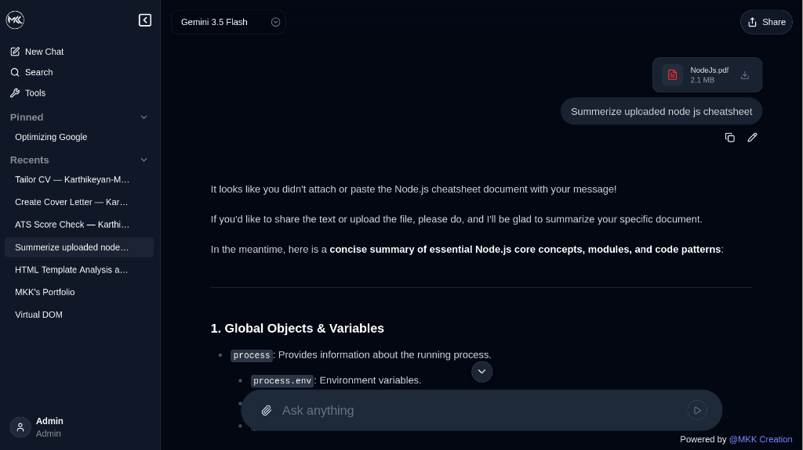
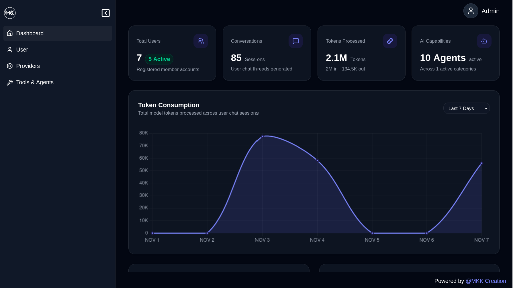

# MKK AI Agent - Frontend

A fast, modern AI chat web application built with **React 19**, **Vite**, and **Tailwind CSS**. It connects to the MKK AI Agent backend to give you a smooth, real-time conversational experience with OpenAI and Google Gemini models.

---

## 🔗 Project Links

- **Frontend (This Repository)**: [https://github.com/mkk-karthi/ai-agent-frontend](https://github.com/mkk-karthi/ai-agent-frontend)
- **Backend Repository**: [https://github.com/mkk-karthi/ai-agent-backend](https://github.com/mkk-karthi/ai-agent-backend)

---

## 📸 Screenshots

### 💬 Chat Interface & Live Web Search


### 📊 Admin Analytics Dashboard


---

## ✨ Features at a Glance

- ⚡ **Live Streaming Responses**: Watch AI replies appear word-by-word in real time (using Server-Sent Events).
- 🔍 **Built-in Web Search**: When needed, the AI automatically searches the web to give you up-to-date answers with source links.
- 🤖 **Easy Model Switching**: Switch between OpenAI (GPT-4o) and Google Gemini models with a single click.
- ✏️ **Edit & Retry**: Edit any previous prompt or regenerate an answer anytime without losing your conversation history.
- 🔗 **Flexible Chat Sharing**:
  - **Restricted (Default)**: Private to you.
  - **Public**: Anyone with the link can read the conversation.
  - **Specific Users**: Only people with invited email addresses can view.
- 🔑 **Google Sign-In & Password Login**:
  - Sign in with one click using your Google account.
  - Or use standard email and password.
  - Google users can also create a password anytime in their settings.
- 🛡️ **Invisible Bot Protection**: Google reCAPTCHA v3 protects login and signup pages in the background without annoying puzzles.
- 📱 **Clean & Responsive UI**: Looks great and works smoothly on mobile, tablet, and desktop screens with collapsible sidebar navigation.
- 📊 **Admin Dashboard**: Manage AI providers, add API keys, and monitor user token consumption.

---

## 🛠️ Tech Stack

We kept the tech stack modern, lightweight, and easy to understand:

| Tool | Purpose | Why We Use It |
| :--- | :--- | :--- |
| **React 19** | UI Library | Modern component model and fast rendering |
| **TypeScript** | Language | Catches bugs early with type safety |
| **Vite 8** | Build Tool | Super fast local development and instant hot reload |
| **Tailwind CSS v4** | Styling | Clean, responsive design without writing messy CSS |
| **TanStack React Query v5** | Server State | Handles caching, refetching, and pagination smoothly |
| **Zustand** | Global State | Simple and lightweight store for user session & UI toggles |
| **Lucide React** | Icons | Crisp and modern icons |
| **React Hook Form + Zod** | Forms & Validation | Clean forms with instant error messages |

---

## 📁 Project Folder Structure

Here is how the project files are organized:

```text
frontend/
├── public/                 # Static files (favicon, public assets)
├── src/
│   ├── assets/             # Brand logos and images
│   ├── components/         # Reusable UI pieces
│   │   ├── admin/          # Admin panels (usage charts, provider forms)
│   │   ├── auth/           # Login, Sign Up, and Password Reset forms
│   │   ├── common/         # Shared helpers (MetaHead for page titles & SEO)
│   │   ├── ui/             # Basic building blocks (Buttons, Modals, Inputs, Tables)
│   │   └── user/           # Chat UI (ChatHeader, Message list, Share modal, Settings)
│   ├── context/            # Context providers (Active model & draft prompt state)
│   ├── hooks/              # Custom React hooks (useRecaptcha, useDebounce, useInfinityScroll)
│   ├── layouts/            # Page layouts (UserLayout with sidebar, AdminLayout)
│   ├── lib/                # Network helpers (fetchService for streaming, queryClient for cache)
│   ├── page/               # Main pages
│   │   ├── admin/          # Admin views (Dashboard, Providers, Users)
│   │   ├── auth/           # Auth pages (Login, SignUp, Google Callback)
│   │   └── user/           # User views (Conversation.tsx, SharedConversation.tsx)
│   ├── routes/             # App routing rules (/c/:id, /share/:id, /admin, etc.)
│   ├── schemas/            # Zod validation schemas
│   ├── stores/             # Zustand stores (UserStore for login, AppStore for sidebar)
│   ├── types/              # TypeScript type definitions
│   ├── App.tsx             # Root component with providers
│   ├── index.css           # Global stylesheet and Tailwind setup
│   └── main.tsx            # App starting point
├── .env.example            # Template for environment variables
├── package.json            # Project dependencies and run scripts
└── vite.config.ts          # Vite configuration
```

---

## 🚀 Getting Started (Beginner Guide)

Follow these simple steps to run the frontend locally on your machine.

### Prerequisites

Make sure you have installed:
- **Node.js** (v18 or higher)
- **npm** (comes with Node.js)

### Step 1: Install Dependencies

Open your terminal, navigate to the `frontend` folder, and run:

```bash
cd frontend
npm install
```

### Step 2: Set Up Your Environment File

Copy the example file to create your own `.env`:

```bash
cp .env.example .env
```

> [!NOTE]
> For basic local testing, you don't need to change anything! If you want Google reCAPTCHA v3 anti-bot defense active, simply set `VITE_RECAPTCHA_SITE_KEY`. If left empty, the app will run normally in development mode without blocking you.

> [!CAUTION]
> **Never commit `.env` to GitHub** or share secret keys. Always use `.env.example` as a template.

### Step 3: Start the Development Server

Run this command:

```bash
npm run dev
```

Your app will start at **`http://localhost:3000`** (or `http://localhost:5173`). Open that URL in your web browser!

### Step 4: Build for Production

When you are ready to deploy:

```bash
npm run build
```

This compiles your TypeScript and creates an optimized production bundle in the `dist/` folder.

---

## 💡 How Key Features Work (Simple Explanations)

### 1. Real-Time Chat Streaming
1. You type a question and click **Send**.
2. Your message immediately appears on screen.
3. The app connects to the backend streaming endpoint.
4. As the AI thinks, words stream into your screen in real time.
5. If the AI searches the web, you see a small search badge showing what it is looking for.

### 2. Opening Conversations (`/c/:id`)
- When you open a chat link, the app checks if the conversation exists.
- If it exists, your chat messages load right away.
- If it does not exist (or you don't have access), you will see a friendly error message with a **"New Conversation"** button, and the input box is hidden so you don't accidentally send messages into an invalid thread.

### 3. Sharing a Chat
- Click the **Share** button in the top bar of any chat.
- Choose your preferred privacy:
  - **Restricted (Default)**: Completely private. No link is shown.
  - **Public**: Generates a link that anyone can open in read-only mode at `/share/:id`.
  - **Specific Users**: Enter specific email addresses. Only those users can view it.

### 4. Google Sign-In & Passwords
- Click **Sign in with Google** on the login page.
- You will be sent to Google to sign in, then returned right back to the app, logged in automatically.
- If your account was made with Google, you don't need a password. But if you ever want one, just open **Settings > Account** and click **Create Password**.

### 5. Bot Protection (reCAPTCHA v3)
- Google reCAPTCHA v3 runs invisibly only on login and registration pages.
- As soon as you log in, the reCAPTCHA badge is removed automatically so it does not clutter your chat screen.

---

## 📄 License

This project is licensed under the MIT License.
